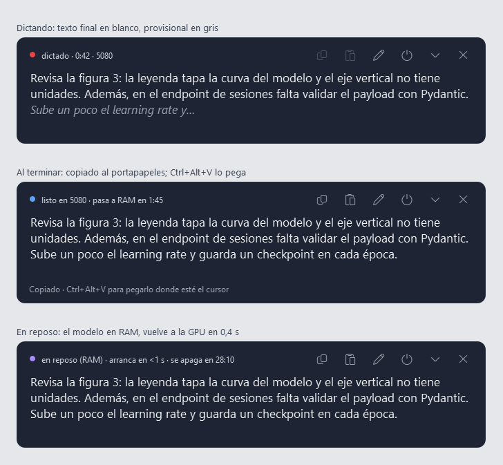
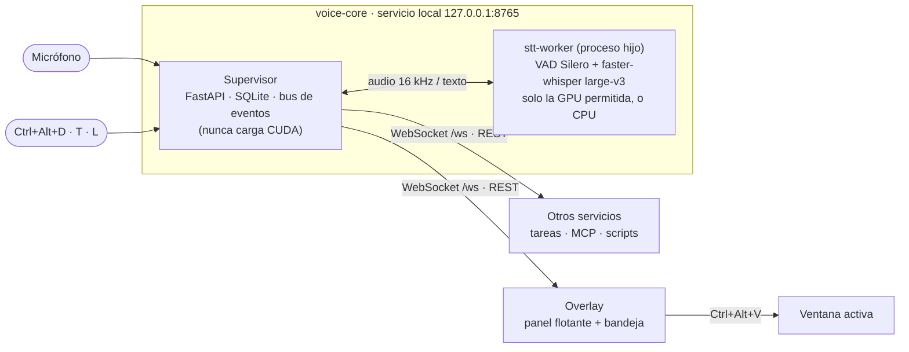
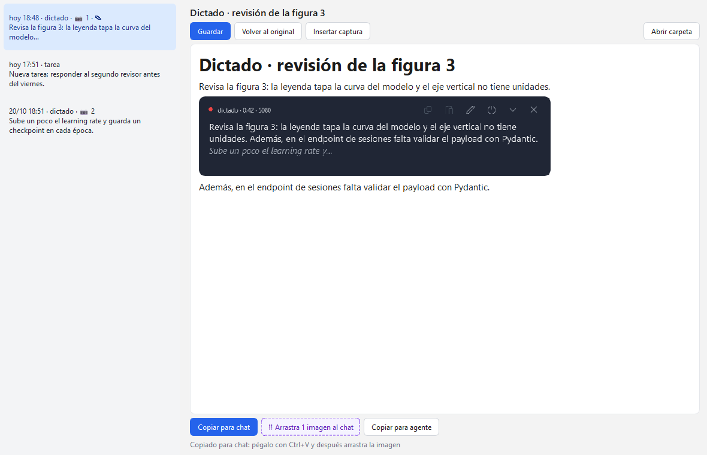

# Desktop Transcriber · Transcriptor RT


Dictado **local y en tiempo real** para Windows. Pulsas `Ctrl+Alt+D`, hablas, y el texto aparece en un panel flotante
encima de lo que estés revisando, **sin quitarle el foco**. Al terminar queda en el portapapeles y `Ctrl+Alt+V` lo pega
donde está el cursor (el chat de un modelo de IA, un editor, un correo…). Con `Ctrl+Alt+S` recortas la pantalla
mientras hablas y la captura queda **en el punto del texto donde la tomaste**; después corriges el dictado en un editor
y lo pasas a un chat o a un agente con sus imágenes. Detrás hay un **servicio** con API REST y WebSocket, para que
otros programas consuman lo que dictas.

> **English summary.** Local, real-time dictation for Windows. Press `Ctrl+Alt+D`, speak, and the text streams into a
> floating always-on-top panel that never steals focus; when you stop, it is copied to the clipboard and `Ctrl+Alt+V`
> pastes it wherever your cursor is. `Ctrl+Alt+S` takes a screenshot (Windows Snipping Tool) that lands exactly where
> you were in the sentence; an editor lets you fix the text and hand it to an AI chat (text with `[Imagen N]` markers
> plus drag-and-drop of every image) or to a coding agent (Markdown with absolute image paths). Speech recognition runs
> on your own GPU (faster-whisper `large-v3` + a custom glossary, ~3 % WER on technical Spanish dictation) or falls back
> to CPU. The model only occupies the GPU while you use it: 2 min on the GPU, then 30 min parked in RAM (wakes up in
> 0.4 s), then fully unloaded. Everything is exposed by a local service (REST + WebSocket on `127.0.0.1:8765`) so other
> tools can consume your dictations. Docs are in Spanish.



## Qué hace

- **Texto en vivo** mientras hablas: provisional en gris cada ~0,4 s y definitivo tras cada pausa (~1 s).
- **Párrafo continuo** en un panel tipo nota adhesiva: siempre encima, translúcido, redimensionable, que no roba el foco.
- **Portapapeles automático** al terminar y **pegado con un atajo** en la ventana activa.
- **Capturas dentro del dictado**: `Ctrl+Alt+S` abre el recorte de Windows y la imagen queda tras la frase que estabas
  diciendo.
- **Editor de dictados** con las imágenes en su sitio y dos salidas para la IA: **chat** (texto con `[Imagen N]` y
  todas las imágenes de un solo arrastre) y **agente** (Markdown con rutas absolutas, más `documento.md` en la carpeta).
- **Precisión con jerga técnica**: glosario propio (endpoint, Pydantic, n8n, LoRA…) → 3,2 % de palabras erróneas en
  dictados reales frente a 7,6 % sin glosario ([F0](docs/F0_SPIKE.md)).
- **Uso responsable de la GPU**: solo la GPU que elijas (nunca otra), el modelo se descarga solo cuando no lo usas y
  cede la memoria si otro programa la necesita.
- **Servicio reutilizable**: sesiones en SQLite, eventos con número de secuencia, API REST + WebSocket con contratos
  OpenAPI y JSON Schema versionados en el repositorio.
- **100 % local**: el audio nunca sale del equipo.

## Cómo funciona



El detalle (procesos, hilos, secuencia de un dictado, ciclo de vida del motor, base de datos) está en
[docs/ARQUITECTURA.md](docs/ARQUITECTURA.md).

## Requisitos

| | Mínimo | Probado |
|---|---|---|
| Sistema | Windows 10/11 | Windows 11 Pro |
| Python | 3.13 (lo instala [uv](https://docs.astral.sh/uv/)) | 3.13.9 |
| GPU (opcional) | NVIDIA con ≥ 3 GB libres y el [CUDA Toolkit 12.x](https://developer.nvidia.com/cuda-downloads) (para cuBLAS) | RTX 5080 (Blackwell), CUDA 12.9 |
| Sin GPU | funciona en CPU: solo texto final, ≈ 4–6 s por frase | i9-14900K |
| Disco | ≈ 3 GB (modelo) + ≈ 0,5 GB (entorno) | |
| Micrófono | cualquiera reconocido por Windows | |

## Instalación

```powershell
git clone https://github.com/JeanCarloMacan/Desktop-transcriber.git
cd Desktop-transcriber
uv sync                                                    # crea .venv (≈ 480 MB, sin PyTorch)
.venv\Scripts\voice-core --descargar-modelo                # faster-whisper large-v3 (≈ 2,9 GB)
.venv\Scripts\pythonw -m overlay                           # panel + bandeja; arranca el servicio oculto
```

Opcional:

```powershell
copy config\voice-core.example.toml config\voice-core.toml          # tu configuración (no se sube a git)
copy config\glosario.example.txt config\glosario.txt                # tu glosario de términos
powershell -ExecutionPolicy Bypass -File scripts\instalar_inicio.ps1  # arrancar con Windows (-Quitar lo quita)
```

En `config/voice-core.toml`, ajusta sobre todo `motor.gpu`: parte del nombre de **la única GPU** que puede usar el motor
(por defecto `"5080"`) o su UUID (`nvidia-smi -L`). Si no coincide con ninguna, o con varias, el motor usa la CPU.

## Uso

| Atajo | Hace |
|---|---|
| `Ctrl+Alt+D` | empieza o termina un dictado |
| `Ctrl+Alt+T` | igual, pero la sesión queda etiquetada como `tarea` |
| `Ctrl+Alt+V` | pega el último dictado donde está el cursor |
| `Ctrl+Alt+S` | recorta la pantalla y adjunta la imagen al dictado en curso (o al último) |
| `Ctrl+Alt+O` | muestra u oculta el panel |
| `Ctrl+Alt+L` | libera la GPU al instante |

En el panel: arrastrar lo mueve; los bordes y las esquinas cambian el tamaño; la rueda desplaza el texto (sin
arrastrarte si estás leyendo más arriba); `Ctrl` + rueda cambia la letra. Todo se recuerda. El icono de la bandeja
cambia de color con el estado y tiene un menú con el modo del motor, el editor, liberar la GPU y salir.

**Editor de dictados** (botón ✎ del panel o menú de la bandeja): lista de dictados, el documento con las capturas en su
sitio para corregirlo, «Insertar captura» en el cursor, **Copiar para chat** (pega el texto y arrastra «N imágenes» al
chat) y **Copiar para agente** (Markdown con las rutas de las PNG). Detalle en [F3](docs/F3_EDITOR.md).



**Ciclo de la GPU tras cada dictado:** 2 min con el modelo en la GPU (≈ 2,2 GB, volver a dictar es instantáneo) → 30 min
en RAM (≈ 0,3 GB en la GPU, despierta en 0,4 s) → apagado (0 GB). Todo configurable.

## Para otros servicios

```powershell
Invoke-RestMethod http://127.0.0.1:8765/engine                      # estado del motor
Invoke-RestMethod http://127.0.0.1:8765/sessions?limit=5            # últimos dictados
Invoke-RestMethod "http://127.0.0.1:8765/sessions/<id>/export?format=md"   # md (agente) · chat · txt
```

```python
import json
from websockets.sync.client import connect

with connect("ws://127.0.0.1:8765/ws?after=0") as ws:   # ?after=N recupera lo que te perdiste
    for mensaje in ws:
        evento = json.loads(mensaje)
        if evento["type"] == "session.finalized":
            print(evento["text"])
```

Endpoints, eventos y ejemplos en [docs/API.md](docs/API.md); los contratos formales están en
[`contracts/openapi.json`](contracts/openapi.json) y [`contracts/eventos.schema.json`](contracts/eventos.schema.json).
Mientras el servicio corre, la documentación interactiva queda en <http://127.0.0.1:8765/docs>.

## Stack tecnológico

| Capa | Tecnología |
|---|---|
| Reconocimiento de voz | [faster-whisper](https://github.com/SYSTRAN/faster-whisper) 1.2 + [CTranslate2](https://github.com/OpenNMT/CTranslate2) 4.8 (`large-v3`, `int8_float16`) |
| Detección de voz | Silero VAD v6 (ONNX Runtime, en CPU) |
| Audio | sounddevice (PortAudio/WASAPI) + soxr (remuestreo a 16 kHz) |
| Servicio | FastAPI + uvicorn + Pydantic v2, WebSocket con `websockets` |
| Persistencia | SQLite (WAL) con migraciones SQL |
| GPU | NVML (`nvidia-ml-py`) para vigilar la VRAM sin crear contexto CUDA; `CUDA_VISIBLE_DEVICES` por UUID |
| Interfaz | PySide6 (Qt 6) + Win32 (`RegisterHotKey`, `WS_EX_NOACTIVATE`, `SendInput`) |
| Herramientas | uv, hatchling, pytest |

Versiones, motivos y licencias de cada pieza en [docs/STACK.md](docs/STACK.md).

## Estructura del repositorio

```
src/voice_core/   servicio: API, motor, worker, segmentador, sesiones, documento, almacén, bus, hotkeys, CLI
src/overlay/      panel flotante, bandeja, editor de dictados, capturas, cliente del servicio y ayudas de Win32
contracts/        OpenAPI y JSON Schema generados desde los modelos (un test vigila que no se desincronicen)
config/           plantillas de configuración y glosario (*.example.*)
docs/             arquitectura, API, stack, desarrollo, diarios de cada fase y diagramas
scripts/          exportar contratos, imágenes del panel y del editor, arranque con Windows
spikes/           experimentos que fundamentaron las decisiones (F0–F2)
tests/            tests unitarios (sin GPU) y de punta a punta con el modelo real (-m gpu)
```

## Documentación

| Documento | Contenido |
|---|---|
| [ARQUITECTURA.md](docs/ARQUITECTURA.md) | componentes, procesos e hilos, secuencia de un dictado, ciclo de vida del motor, datos, decisiones |
| [API.md](docs/API.md) | REST, WebSocket, eventos y ejemplos |
| [STACK.md](docs/STACK.md) | tecnologías, versiones, por qué cada una y sus licencias |
| [DESARROLLO.md](docs/DESARROLLO.md) | entorno de desarrollo, tests, contratos, convenciones y solución de problemas |
| [F0 · motor](docs/F0_SPIKE.md) · [F1 · servicio](docs/F1_VOICE_CORE.md) · [F2 · panel](docs/F2_OVERLAY.md) · [F3 · editor](docs/F3_EDITOR.md) | diario de cada fase: especificación, mediciones, pruebas reales y correcciones |
| [Plan general](docs/planes/plan-transcriptor-rt.svg) · [Recursos y modos](docs/planes/recursos-y-modos.svg) | diagramas del plan y del uso de la GPU |
| [CHANGELOG.md](CHANGELOG.md) | cambios por versión |

## Hoja de ruta

- [x] **F0** · Elección del motor con mediciones reales (large-v3 + glosario).
- [x] **F1** · Servicio `voice-core`: captura, VAD, transcripción en vivo, sesiones, API y eventos.
- [x] **F2** · Panel flotante, bandeja, atajos, pegado, reposo en RAM y arranque con Windows.
- [x] **F3** · Capturas de pantalla dentro del dictado, editor de sesiones y «Copiar para IA» (chat o agente).
- [ ] **F4** · Organizador de tareas por categorías que consume los dictados (LLM local con LM Studio).
- [ ] **F5** · Servidor MCP, webhooks y limpieza opcional del texto con un LLM.

## Licencia

[MIT](LICENSE). Las dependencias tienen sus propias licencias; en particular PySide6/Qt se usa bajo LGPL-3.0 y el
modelo Whisper large-v3 de OpenAI es MIT (detalle en [docs/STACK.md](docs/STACK.md)).
