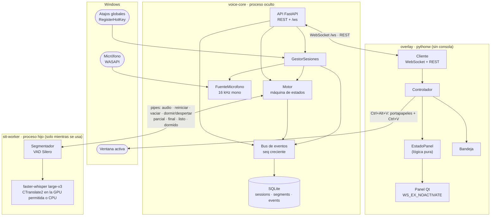
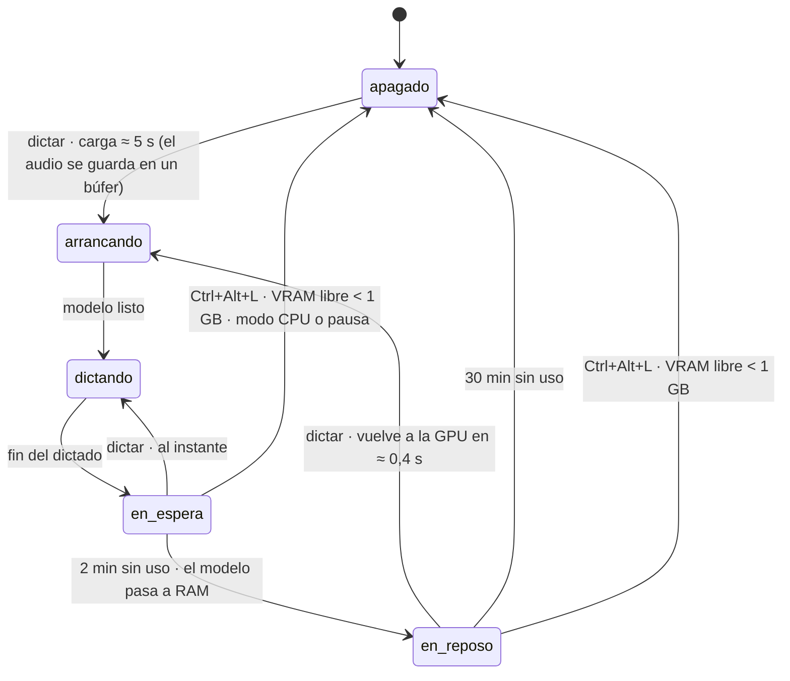
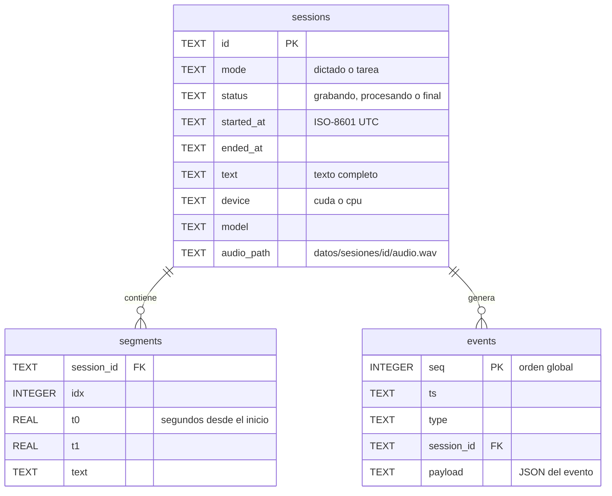

# Arquitectura

Transcriptor RT son **dos programas** que se hablan por HTTP/WebSocket en `127.0.0.1:8765`:

- **voice-core** (`src/voice_core/`): el servicio. Graba, transcribe, guarda y publica eventos. No tiene interfaz.
- **overlay** (`src/overlay/`): el panel flotante y el icono de la bandeja. Es solo un cliente más de voice-core.

Esa separación es deliberada: cualquier otro programa (un organizador de tareas, un servidor MCP, un script) puede
consumir los dictados exactamente igual que el panel.

## Componentes



| Módulo | Responsabilidad |
|---|---|
| `voice_core/contratos.py` | Modelos Pydantic de la API y de los eventos: **fuente de verdad** del contrato. |
| `voice_core/api.py` | Rutas REST y WebSocket; ciclo de vida del servidor. |
| `voice_core/sesiones.py` | Une micrófono, motor, almacén y bus. Una sesión activa a la vez. |
| `voice_core/motor.py` | Elige dispositivo, lanza y cierra el worker, estados `apagado → arrancando → dictando ⇄ en_espera → en_reposo`. |
| `voice_core/worker.py` | El proceso hijo (`spawn`) con el modelo y su manejador en el supervisor. |
| `voice_core/segmentador.py` | Lógica pura: ventanas de 32 ms, VAD, frases, parciales y finales, filtro de alucinaciones. |
| `voice_core/almacen.py` + `migraciones/` | SQLite con migraciones SQL versionadas (`PRAGMA user_version`). |
| `voice_core/bus.py` | Persiste los eventos no efímeros y los reparte a los suscriptores. |
| `voice_core/gpu.py` | NVML (VRAM sin contexto CUDA), elección de la GPU por nombre o UUID, DLLs de CUDA. |
| `voice_core/hotkeys.py` | Atajos globales con `RegisterHotKey` en un hilo con bucle de mensajes. |
| `voice_core/audio.py` | Micrófono (PortAudio) y fuente de archivo para pruebas. |
| `overlay/estado.py` | Lógica pura del panel: eventos → qué se muestra y qué acciones tomar. |
| `overlay/panel.py`, `bandeja.py` | Interfaz Qt. |
| `overlay/cliente.py`, `servicio.py`, `escritorio.py` | Conexión con voice-core, su arranque/cierre y ayudas de Win32. |

## Un dictado de principio a fin

```mermaid
sequenceDiagram
    autonumber
    actor U as Usuario
    participant H as Atajos (Win32)
    participant S as GestorSesiones
    participant M as Motor
    participant W as stt-worker
    participant B as Bus + SQLite
    participant O as Overlay

    U->>H: Ctrl+Alt+D
    H->>S: alternar("dictado")
    S->>M: encender()
    Note over M,W: si estaba apagado, lanza el worker (≈ 5 s);<br/>si estaba en reposo, lo despierta (≈ 0,4 s)
    M-->>B: engine.state · arrancando
    S->>B: session.started
    B-->>O: el panel aparece (sin quitar el foco)
    loop cada 50 ms
        S->>M: audio 16 kHz
        M->>W: audio (o al búfer mientras carga: no se pierde nada)
    end
    W-->>M: listo
    M-->>B: engine.state · dictando
    loop mientras hablas
        W-->>S: parcial (cada 0,4 s de audio)
        S-->>B: segment.partial (efímero, sin seq)
        B-->>O: texto provisional en gris
        W-->>S: final (tras 1 s de pausa)
        S->>B: segment.final (persistido con seq)
        B-->>O: texto definitivo
    end
    U->>H: Ctrl+Alt+D
    H->>S: detener()
    S->>M: vaciar
    W-->>S: último final + vaciado
    S->>B: session.finalized (texto completo, audio.wav)
    B-->>O: copia al portapapeles · se desvanece a los 15 s
    M-->>B: engine.state · en_espera
```

## Ciclo de vida del motor



| Estado | Modelo | GPU ocupada | Siguiente dictado empieza en |
|---|---|---|---|
| `apagado` | — | 0 | 5–11 s |
| `en_espera` | GPU | ≈ 2,2 GB | al instante |
| `en_reposo` | RAM (`unload_model(to_cpu=True)`) | ≈ 250–380 MB (contexto CUDA) | ≈ 0,4 s |

Reglas: nunca se apaga a mitad de un dictado; en CPU no hay reposo (se apaga a los 2 min); si el worker muere al cargar
en GPU en modo `auto`, se reintenta en CPU conservando el audio encolado.

## Política de GPU

- **Una sola GPU permitida**, configurada en `motor.gpu` por nombre («5080») o UUID. Si el nombre no coincide con
  ninguna o coincide con varias, no se usa ninguna (CPU): es preferible a cargar el modelo donde no toca.
- El worker arranca con `CUDA_VISIBLE_DEVICES=<UUID>` **antes** de importar CTranslate2 y comprueba que ve exactamente
  1 GPU; si no, aborta. El supervisor nunca importa CUDA.
- La VRAM se vigila con **NVML**, que no crea contexto CUDA. Modo `auto`: GPU si quedan ≥ 3 GB libres; si no, CPU.
- **Ceder la GPU**: en espera o reposo, si la VRAM libre baja de 1 GB (otro programa la necesita), el motor se apaga.
- Liberar del todo exige **cerrar el proceso**: borrar el modelo deja ≈ 240 MB de contexto CUDA.

## Segmentación y transcripción

| Parámetro | Valor | Por qué |
|---|---|---|
| Ventana de VAD | 512 muestras (32 ms) | Silero VAD en streaming, con estado entre ventanas |
| Pausa que cierra una frase | 1000 ms | con 700 ms las pausas para pensar partían frases ([F1](F1_VOICE_CORE.md)) |
| Frase máxima | 28 s | Whisper trabaja en ventanas de 30 s |
| Primer parcial | tras 0,8 s de frase | con menos audio Whisper inventaba créditos de subtítulos |
| Parcial | cada 0,4 s, beam 1 | ≈ 0,16 s por refresco en la GPU |
| Final | beam 5 + glosario en `initial_prompt` | 3,2 % WER con jerga técnica ([F0](F0_SPIKE.md)) |
| Filtro | `no_speech_prob > 0,6` y `avg_logprob < −1`, más créditos conocidos («Subtítulos por…») | alucinaciones sobre silencio |

## Datos



- `datos/voice-core.db` (SQLite en modo WAL), `datos/sesiones/<id>/audio.wav` (16 kHz, ≈ 1,9 MB/min, desactivable),
  `datos/overlay.json` (posición y tamaño del panel) y los registros `datos/*.log`. Nada de `datos/` va a git.
- Los eventos `segment.partial` son **efímeros**: solo viajan por WebSocket. El resto se persisten con `seq` y se
  pueden recuperar con `GET /events?after=N` o `WS /ws?after=N` (sin huecos aunque el cliente se reconecte).
- Tras un cierre brusco, las sesiones que quedaron abiertas pasan a `final` con lo que tengan al arrancar.

## Procesos e hilos

| Proceso | Hilos | Notas |
|---|---|---|
| **overlay** (`pythonw -m overlay`) | Qt (principal) · WebSocket · REST (uno por petición) · atajos · pegado | Mutex de instancia única; si voice-core no responde, lo lanza oculto (`python` + `CREATE_NO_WINDOW`) y lo cierra con `POST /shutdown` al salir. |
| **voice-core** (`python -m voice_core`) | bucle asyncio (FastAPI, bus, sesiones, motor) · audio (callback de PortAudio) · atajos · emisor y lector del pipe | Todo lo que llega de otros hilos entra al bucle con `call_soon_threadsafe`. |
| **stt-worker** (`multiprocessing`, `spawn`) | principal (VAD + transcripción) · recepción del pipe | Junta el audio atrasado en un lote: después de cargar procesa el búfer de una vez. Si el supervisor muere, el pipe da EOF y el worker sale. |

## Contratos

`src/voice_core/contratos.py` es la fuente de verdad. `scripts/exportar_contratos.py` genera
`contracts/openapi.json` y `contracts/eventos.schema.json`, y un test falla si se desincronizan. Ver [API.md](API.md).

## Configuración

Orden de búsqueda: `TRT_CONFIG` → `config/voice-core.toml` (personal, fuera de git) →
`config/voice-core.example.toml` (plantilla). Las rutas relativas parten de la raíz del proyecto. Todas las claves
tienen valor por defecto en `voice_core/ajustes.py`; las secciones son `servidor`, `datos`, `motor`, `segmentacion`,
`audio`, `hotkeys` y `overlay`.

## Decisiones principales

| Decisión | Alternativas descartadas | Dónde se justifica |
|---|---|---|
| faster-whisper `large-v3` `int8_float16` + glosario | turbo (3× más rápido pero 9,5 % WER con jerga), Parakeet, nube | [F0](F0_SPIKE.md) |
| Entorno propio sin PyTorch; cuBLAS del CUDA Toolkit | reutilizar otro venv (5 GB, acoplado) | [F0](F0_SPIKE.md) |
| Supervisor sin CUDA + worker en proceso hijo | todo en un proceso (no se puede liberar la VRAM del todo) | [F1](F1_VOICE_CORE.md) |
| Pausa de 1000 ms, sin contexto entre frases | 700 ms (frases partidas); texto previo como prompt (inventa y repite) | [F1](F1_VOICE_CORE.md) |
| Reposo del modelo en RAM 30 min | apagar a los 2 min (arranques de 5–11 s) | [F2](F2_OVERLAY.md) |
| Panel PySide6 como cliente de la API | Tauri, Electron, tkinter | [Plan](planes/plan-transcriptor-rt.svg), [F2](F2_OVERLAY.md) |
| Eventos con `seq` + recuperación por `?after=` | broker (NATS/Redis), webhooks | [Plan](planes/plan-transcriptor-rt.svg) |

Diagramas complementarios: [plan general](planes/plan-transcriptor-rt.svg) y
[recursos, modos y apagado](planes/recursos-y-modos.svg).
