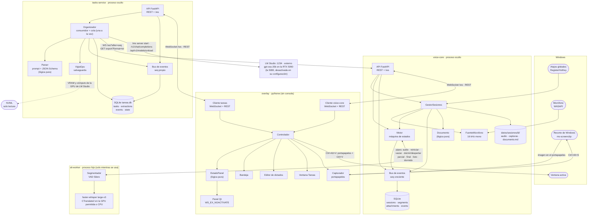
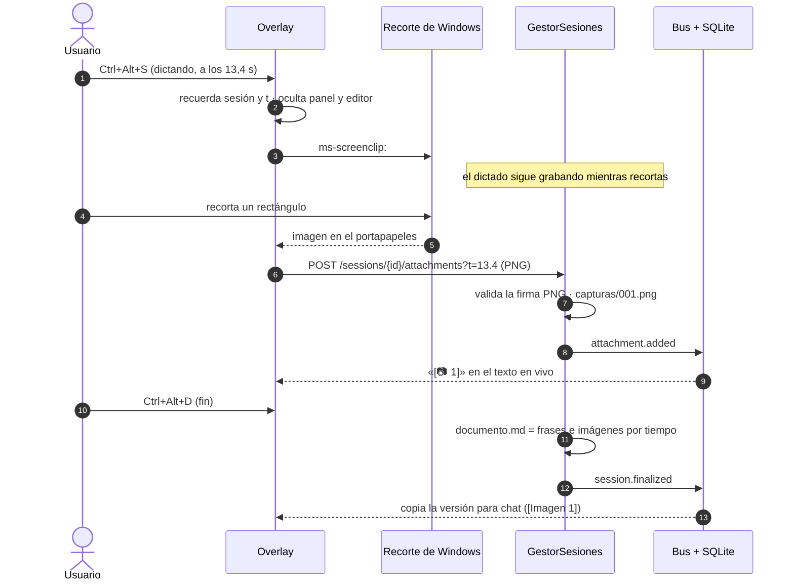
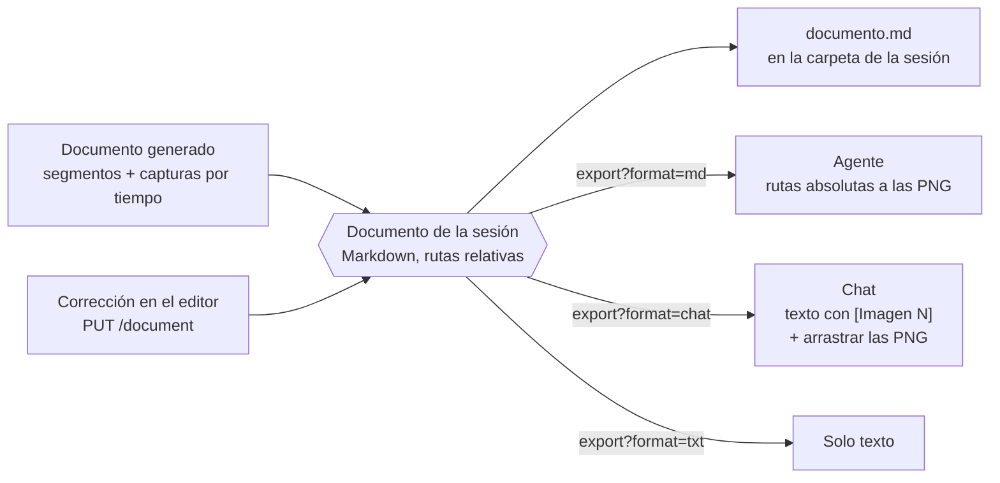
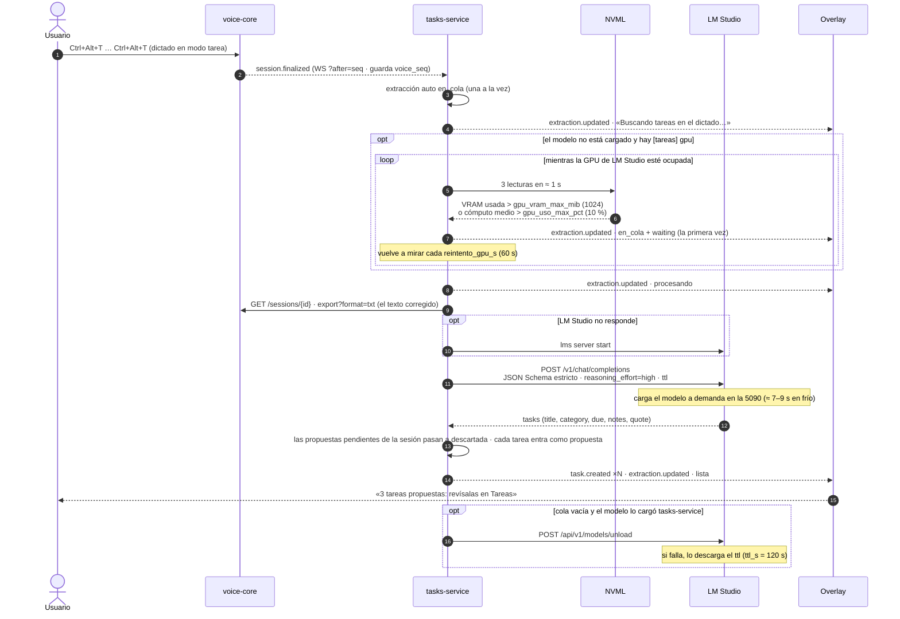
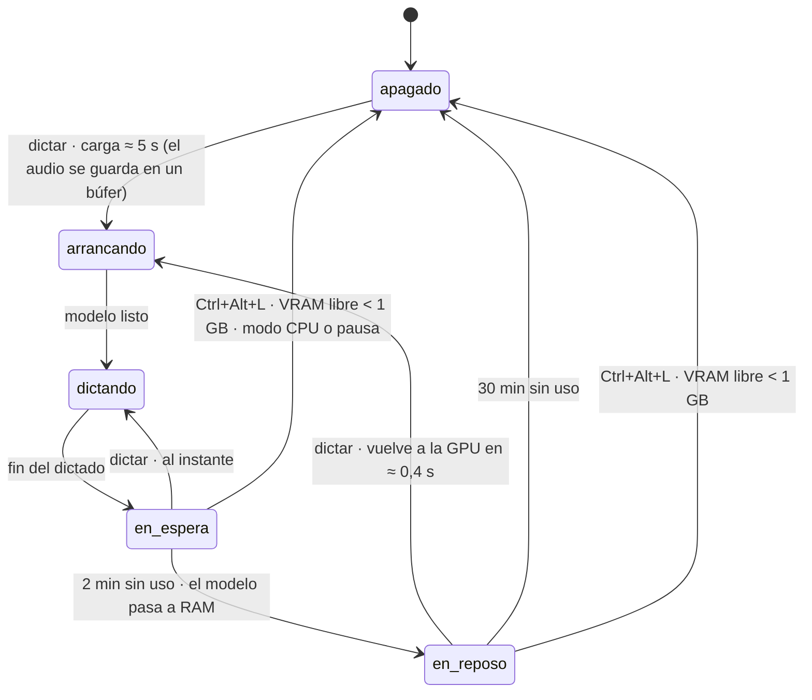
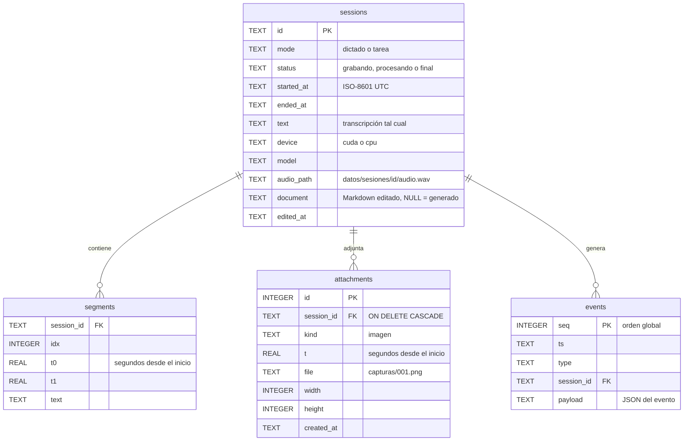
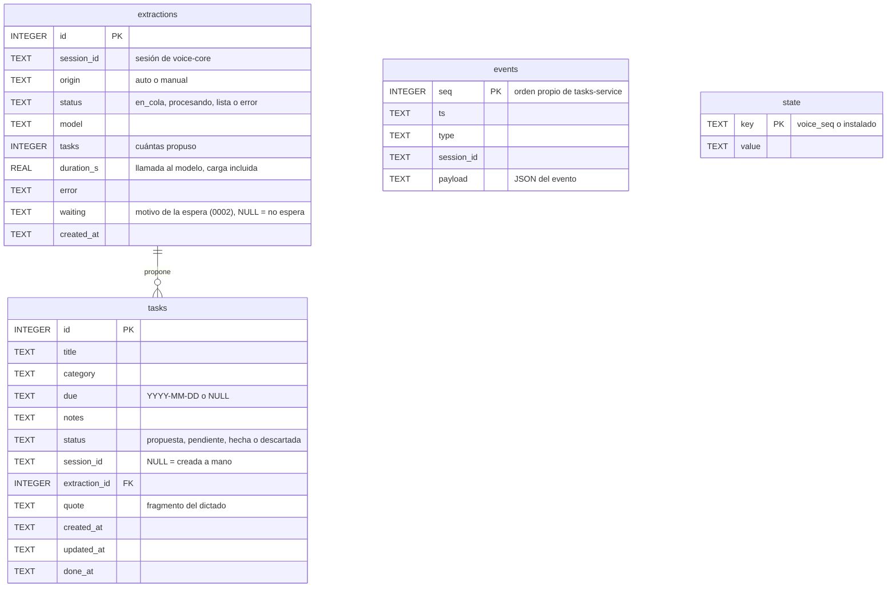

# Arquitectura

Transcriptor RT son **tres programas** que se hablan por HTTP/WebSocket en `127.0.0.1`:

- **voice-core** (`src/voice_core/`, `:8765`): el servicio de voz. Graba, transcribe, guarda y publica eventos. No
  tiene interfaz.
- **tasks-service** (`src/tasks_service/`, `:8766`): el organizador de tareas ([F4](F4_TAREAS.md)). Consume los
  dictados de voice-core, extrae las tareas con un modelo local de **LM Studio** (`:1234`) y las deja como propuestas.
  Tampoco tiene interfaz.
- **overlay** (`src/overlay/`): el panel flotante, la bandeja, el editor y la ventana Tareas. Es solo un cliente más
  de los dos servicios, y el que los lanza ocultos.

Esa separación es deliberada: cualquier otro programa (un servidor MCP, un script) puede consumir los dictados
exactamente igual que el panel. tasks-service es justo eso: un consumidor más de la API de voice-core, sin acceso a
su base ni a su proceso.

## Componentes



| Módulo | Responsabilidad |
|---|---|
| `voice_core/contratos.py` | Modelos Pydantic de la API y de los eventos: **fuente de verdad** del contrato. |
| `voice_core/api.py` | Rutas REST y WebSocket; ciclo de vida del servidor. |
| `voice_core/sesiones.py` | Une micrófono, motor, almacén y bus. Una sesión activa a la vez. Capturas y documento de cada sesión. |
| `voice_core/documento.py` | Lógica pura del documento: párrafos e imágenes por tiempo, re-unir párrafos, exportar para chat, agente o texto. |
| `voice_core/motor.py` | Elige dispositivo, lanza y cierra el worker, estados `apagado → arrancando → dictando ⇄ en_espera → en_reposo`. |
| `voice_core/worker.py` | El proceso hijo (`spawn`) con el modelo y su manejador en el supervisor. |
| `voice_core/segmentador.py` | Lógica pura: ventanas de 32 ms, VAD, frases, parciales y finales, filtro de alucinaciones y del eco del glosario (`eco_del_glosario`). |
| `voice_core/almacen.py` + `migraciones/` | SQLite con migraciones SQL versionadas (`PRAGMA user_version`). `BaseSqlite` (conexión, migraciones y eventos) la comparte tasks-service. |
| `voice_core/bus.py` | Persiste los eventos no efímeros y los reparte a los suscriptores. tasks-service lo reutiliza con sus propios eventos. |
| `voice_core/gpu.py` | NVML (VRAM y cómputo sin contexto CUDA), elección de la GPU por nombre o UUID, DLLs de CUDA. |
| `voice_core/ajustes.py` | Toda la configuración (`[servidor] … [overlay] [tareas]`) con valores por defecto; la leen los tres programas. |
| `voice_core/hotkeys.py` | Atajos globales con `RegisterHotKey` en un hilo con bucle de mensajes. |
| `voice_core/audio.py` | Micrófono (PortAudio) y fuente de archivo para pruebas. |
| `tasks_service/contratos.py` | Modelos Pydantic de la API de tareas y de sus eventos: **fuente de verdad** de su contrato. |
| `tasks_service/api.py` | Rutas REST y WebSocket de tasks-service; ciclo de vida del servidor. |
| `tasks_service/organizador.py` | Consumidor de voice-core (`WS ?after=seq`), cola de extracciones (una a la vez), salvaguarda de la GPU, llamada al modelo, propuestas y descarga del modelo al vaciarse la cola. |
| `tasks_service/parser.py` | Lógica pura: prompt con la fecha del dictado y un calendario de 21 días, JSON Schema con las categorías cerradas y validación de la respuesta. |
| `tasks_service/llm.py` | Cliente de LM Studio: `/v1/chat/completions` con JSON Schema estricto y `ttl`, si el modelo está cargado (`/api/v0/models/…`), `lms server start` y descarga por `/api/v1/models/unload`. |
| `tasks_service/gpu.py` | Salvaguarda: `VigiaGpu` lee la GPU de LM Studio por NVML y `motivo_ocupada` (lógica pura) decide si está ocupada. |
| `tasks_service/voz.py` | Lo que necesita de voice-core por REST: la sesión y su texto (`export?format=txt`). |
| `tasks_service/almacen.py` + `migraciones/` | `datos/tareas.db`: tareas, extracciones, eventos y estado del consumidor. |
| `overlay/estado.py` | Lógica pura del panel: eventos → qué se muestra y qué acciones tomar. |
| `overlay/panel.py`, `bandeja.py` | Interfaz Qt. |
| `overlay/editor.py` | Editor de dictados: lista de sesiones, documento con las imágenes, copiar para chat o agente, arrastrar las imágenes, «Extraer tareas». |
| `overlay/tareas.py` | Ventana Tareas: Propuestas, una lista por categoría y Hechas; aprobar, editar, descartar, marcar hecha y añadir a mano. Se actualiza con `task.created` y `task.updated`. |
| `overlay/capturas.py` | Lanza el recorte de Windows y espera la imagen en el portapapeles (o se rinde a los 60 s). |
| `overlay/cliente.py`, `servicio.py`, `escritorio.py` | Conexión con voice-core y tasks-service, su arranque/cierre y ayudas de Win32. |

## Un dictado de principio a fin

```mermaid
sequenceDiagram
    autonumber
    actor U as Usuario
    participant H as Atajos (Win32)
    participant S as GestorSesiones
    participant M as Motor
    participant W as stt-worker
    participant B as Bus + SQLite
    participant O as Overlay

    U->>H: Ctrl+Alt+D
    H->>S: alternar("dictado")
    S->>M: encender()
    Note over M,W: si estaba apagado, lanza el worker (≈ 5 s);<br/>si estaba en reposo, lo despierta (≈ 0,4 s)
    M-->>B: engine.state · arrancando
    S->>B: session.started
    B-->>O: el panel aparece (sin quitar el foco)
    loop cada 50 ms
        S->>M: audio 16 kHz
        M->>W: audio (o al búfer mientras carga: no se pierde nada)
    end
    W-->>M: listo
    M-->>B: engine.state · dictando
    loop mientras hablas
        W-->>S: parcial (cada 0,4 s de audio)
        S-->>B: segment.partial (efímero, sin seq)
        B-->>O: texto provisional en gris
        W-->>S: final (tras 1 s de pausa)
        S->>B: segment.final (persistido con seq)
        B-->>O: texto definitivo
    end
    U->>H: Ctrl+Alt+D
    H->>S: detener()
    S->>M: vaciar
    S->>B: session.stopped (micrófono cerrado)
    B-->>O: el reloj se para (si el modelo aún carga, lo dice)
    W-->>S: último final + vaciado
    S->>B: session.finalized (texto completo, audio.wav)
    B-->>O: copia al portapapeles · se desvanece a los 15 s
    M-->>B: engine.state · en_espera
```

`session.stopped` separa «ya no se escucha» de «ya está el texto»: si se para mientras el modelo aún carga, lo grabado
se conserva y se transcribe al terminar la carga, y el panel lo explica en vez de seguir con «Escuchando…».

## Capturas y documento

Una captura se ata a **un instante** de la sesión (`t`, en segundos desde el inicio). El documento se arma ordenando
frases e imágenes por tiempo: cada imagen va tras la última frase que empezó antes de ella, que es la que estabas
diciendo al pulsar.





- Mientras no se edita, el documento se **genera** cada vez; al guardarlo, se conserva el Markdown editado
  (`sessions.document`) y `DELETE /document` vuelve al generado. Una captura que llega después de editar se añade al
  final.
- El editor muestra el Markdown con `QTextEdit`, que corta las líneas a 80 columnas al exportarlo; el servicio re-une
  los párrafos al guardar y al exportar.
- Las imágenes nunca se borran: quitar una imagen del documento la saca de las exportaciones, pero el archivo sigue
  en `capturas/`.

## Tareas: de un dictado a las propuestas

Un dictado con `Ctrl+Alt+T` (modo `tarea`) pasa solo al organizador; cualquier otro, con «Extraer tareas» en el
editor (`POST /extractions`). Las extracciones van a una **cola y se procesan de una en una**: el modelo es uno solo
y las llamadas en paralelo solo competirían.



- **No pierde dictados**: el último `seq` de voice-core procesado se guarda en `state.voice_seq` y el consumidor se
  reconecta con `?after=`. Si tasks-service estaba apagado mientras dictabas, procesa al arrancar los dictados de
  tarea pendientes; las extracciones que quedaron en cola o a medias se retoman. Cada dictado de tarea se extrae solo
  **una vez** (una extracción `auto` por sesión) y nunca los anteriores a la instalación (`state.instalado`).
- **Bandeja de propuestas**: el modelo nunca escribe en la lista. Cada tarea entra como `propuesta` y tú la apruebas
  (`pendiente`), la corriges o la descartas. Repetir la extracción de una sesión **sustituye** sus propuestas
  pendientes; las aprobadas no se tocan.
- **El prompt** lleva las categorías con su descripción, la fecha del dictado y un calendario de los 21 días
  siguientes (para resolver «el viernes» o «fin de mes»); el **JSON Schema** cierra `category` a las configuradas y
  `due` a `YYYY-MM-DD` o `null`. LM Studio lo impone al generar y `parser.interpretar` lo valida de nuevo.
- **Salvaguarda de la GPU**: tasks-service no puede elegir en qué GPU carga el modelo LM Studio, pero sí **cuándo**
  pedir la carga. Antes de cada extracción, si el modelo no está cargado, lee la GPU de LM Studio (`[tareas] gpu`) por
  NVML: la VRAM usada (la lectura más alta) y el cómputo (la media, para que un pico suelto de otro programa no
  bloquee). Si está ocupada, la extracción sigue `en_cola` con el motivo en `waiting` y el panel y la ventana Tareas
  lo avisan. Si el modelo ya está cargado, no hay nada que reservar y no se espera; si NVML no puede leer la GPU, se
  avisa en el registro y se extrae igualmente; con `gpu = ""` no se comprueba nada.
- **Ligero**: el modelo (12 GB) solo ocupa la GPU mientras se extrae. Al vaciarse la cola, si lo cargó tasks-service,
  se descarga en el acto; un modelo que ya estaba cargado antes (lo cargaste tú en LM Studio) no se toca. El `ttl` de
  cada petición es la red de seguridad.
- **Errores**: si LM Studio no responde ni tras `lms server start`, la respuesta no es válida o voice-core no
  contesta, la extracción queda en `error` con el motivo y se puede repetir.

## Ciclo de vida del motor



| Estado | Modelo | GPU ocupada | Siguiente dictado empieza en |
|---|---|---|---|
| `apagado` | — | 0 | 5–11 s |
| `en_espera` | GPU | ≈ 2,2 GB | al instante |
| `en_reposo` | RAM (`unload_model(to_cpu=True)`) | ≈ 250–380 MB (contexto CUDA) | ≈ 0,4 s |

Reglas: nunca se apaga a mitad de un dictado; en CPU no hay reposo (se apaga a los 2 min); si el worker muere al cargar
en GPU en modo `auto`, se reintenta en CPU conservando el audio encolado.

## Política de GPU

- **Una sola GPU permitida**, configurada en `motor.gpu` por nombre («5080») o UUID. Si el nombre no coincide con
  ninguna o coincide con varias, no se usa ninguna (CPU): es preferible a cargar el modelo donde no toca.
- El worker arranca con `CUDA_VISIBLE_DEVICES=<UUID>` **antes** de importar CTranslate2 y comprueba que ve exactamente
  1 GPU; si no, aborta. El supervisor nunca importa CUDA.
- La VRAM se vigila con **NVML**, que no crea contexto CUDA. Modo `auto`: GPU si quedan ≥ 3 GB libres; si no, CPU.
- **Ceder la GPU**: en espera o reposo, si la VRAM libre baja de 1 GB (otro programa la necesita), el motor se apaga.
- Liberar del todo exige **cerrar el proceso**: borrar el modelo deja ≈ 240 MB de contexto CUDA.
- **Tareas**: el modelo de LM Studio va en la **RTX 5090**, nunca en la 5080: LM Studio tiene la 5080 desactivada en
  su propia configuración (que el proyecto no toca), así que no compite con el reconocimiento de voz. tasks-service
  nunca importa CUDA: solo lee NVML para la salvaguarda (`[tareas] gpu`) y pide la carga y la descarga por la API de
  LM Studio.

## Segmentación y transcripción

| Parámetro | Valor | Por qué |
|---|---|---|
| Ventana de VAD | 512 muestras (32 ms) | Silero VAD en streaming, con estado entre ventanas |
| Pausa que cierra una frase | 1000 ms | con 700 ms las pausas para pensar partían frases ([F1](F1_VOICE_CORE.md)) |
| Frase máxima | 28 s | Whisper trabaja en ventanas de 30 s |
| Primer parcial | tras 0,8 s de frase | con menos audio Whisper inventaba créditos de subtítulos |
| Parcial | cada 0,4 s, beam 1 | ≈ 0,16 s por refresco en la GPU |
| Final | beam 5 + glosario en `initial_prompt` | 3,2 % WER con jerga técnica ([F0](F0_SPIKE.md)) |
| Filtro | `no_speech_prob > 0,6` y `avg_logprob < −1`, más créditos conocidos («Subtítulos por…») | alucinaciones sobre silencio |
| Eco del glosario | se descarta cada segmento de Whisper de dos palabras o más que está tal cual en el glosario y no es uno de sus términos (`eco_del_glosario`, aplicado por segmento en el worker) | Whisper a veces escribe en una pausa un trozo del glosario que recibe como `initial_prompt` («Términos frecuentes.»); decir un término suelto sigue siendo válido ([F4](F4_TAREAS.md)) |

## Datos



- `datos/voice-core.db` (SQLite en modo WAL), `datos/overlay.json` (posición y tamaño del panel) y los registros
  `datos/*.log`. Nada de `datos/` va a git.
- Cada sesión tiene su carpeta `datos/sesiones/<id>/`: `audio.wav` (16 kHz, ≈ 1,9 MB/min, desactivable),
  `capturas/NNN.png` y `documento.md` (rutas relativas, para entregar la carpeta entera a un agente).
- Los eventos `segment.partial` son **efímeros**: solo viajan por WebSocket. El resto se persisten con `seq` y se
  pueden recuperar con `GET /events?after=N` o `WS /ws?after=N` (sin huecos aunque el cliente se reconecte).
- Tras un cierre brusco, las sesiones que quedaron abiertas pasan a `final` con lo que tengan al arrancar.

tasks-service tiene su propia base, `datos/tareas.db` (SQLite en modo WAL, mismas migraciones versionadas con
`BaseSqlite`). Las sesiones de voice-core se citan por `session_id`, sin clave ajena: son otra base y otro proceso.



- Migraciones: `0001_inicial.sql` (las cuatro tablas) y `0002_espera_gpu.sql` (columna `extractions.waiting`, para la
  salvaguarda de la GPU), aplicadas solas sobre las bases anteriores.
- `state` guarda `voice_seq` (el último evento de voice-core procesado) e `instalado` (desde cuándo hay organizador:
  los dictados de antes no se procesan solos).
- Todos los eventos de tasks-service son persistentes; su `seq` es independiente del de voice-core.

## Procesos e hilos

| Proceso | Hilos | Notas |
|---|---|---|
| **overlay** (`pythonw -m overlay`) | Qt (principal) · WebSocket y REST (uno por petición) de cada servicio · atajos · pegado | Mutex de instancia única; si voice-core o tasks-service no responden, los lanza ocultos (`python` + `CREATE_NO_WINDOW`; tasks-service desde un hilo, sin retrasar el panel) y los cierra con `POST /shutdown` al salir. |
| **voice-core** (`python -m voice_core`) | bucle asyncio (FastAPI, bus, sesiones, motor) · audio (callback de PortAudio) · atajos · emisor y lector del pipe | Todo lo que llega de otros hilos entra al bucle con `call_soon_threadsafe`. |
| **stt-worker** (`multiprocessing`, `spawn`) | principal (VAD + transcripción) · recepción del pipe | Junta el audio atrasado en un lote: después de cargar procesa el búfer de una vez. Si el supervisor muere, el pipe da EOF y el worker sale. |
| **tasks-service** (`python -m tasks_service`) | bucle asyncio (FastAPI, bus, consumidor de voice-core, cola de extracciones) · hilos de `asyncio.to_thread` para lo que bloquea (LM Studio, REST de voice-core, NVML) | Nunca importa CUDA. Si voice-core no está, reintenta la conexión cada 2 s. Registro en `datos/tasks-service.log`. |
| **LM Studio** (externo, `:1234`) | — | No es parte del proyecto: lo arranca el usuario o, si su servidor no responde, tasks-service con `lms server start`. Carga el modelo a demanda en la 5090. |

## Contratos

`src/voice_core/contratos.py` y `src/tasks_service/contratos.py` son la fuente de verdad.
`scripts/exportar_contratos.py` genera `contracts/openapi.json` y `contracts/eventos.schema.json` (voice-core), y
`contracts/tareas.openapi.json` y `contracts/tareas.eventos.schema.json` (tasks-service); un test falla si se
desincronizan. Ver [API.md](API.md).

## Configuración

Orden de búsqueda: `TRT_CONFIG` → `config/voice-core.toml` (personal, fuera de git) →
`config/voice-core.example.toml` (plantilla). Las rutas relativas parten de la raíz del proyecto. Todas las claves
tienen valor por defecto en `voice_core/ajustes.py`; las secciones son `servidor`, `datos`, `motor`, `segmentacion`,
`audio`, `hotkeys`, `overlay` y `tareas` (con `tareas.categorias`). tasks-service lee el mismo archivo (el overlay se
lo pasa con `--config`).

## Decisiones principales

| Decisión | Alternativas descartadas | Dónde se justifica |
|---|---|---|
| faster-whisper `large-v3` `int8_float16` + glosario | turbo (3× más rápido pero 9,5 % WER con jerga), Parakeet, nube | [F0](F0_SPIKE.md) |
| Entorno propio sin PyTorch; cuBLAS del CUDA Toolkit | reutilizar otro venv (5 GB, acoplado) | [F0](F0_SPIKE.md) |
| Supervisor sin CUDA + worker en proceso hijo | todo en un proceso (no se puede liberar la VRAM del todo) | [F1](F1_VOICE_CORE.md) |
| Pausa de 1000 ms, sin contexto entre frases | 700 ms (frases partidas); texto previo como prompt (inventa y repite) | [F1](F1_VOICE_CORE.md) |
| Reposo del modelo en RAM 30 min | apagar a los 2 min (arranques de 5–11 s) | [F2](F2_OVERLAY.md) |
| Panel PySide6 como cliente de la API | Tauri, Electron, tkinter | [Plan](planes/plan-transcriptor-rt.svg), [F2](F2_OVERLAY.md) |
| Eventos con `seq` + recuperación por `?after=` | broker (NATS/Redis), webhooks | [Plan](planes/plan-transcriptor-rt.svg) |
| Capturas con el recorte de Windows (`ms-screenclip:`) | herramienta de recorte propia (más código que mantener; la de Windows ya deja anotar antes de copiar) | [F3](F3_EDITOR.md) |
| Documento en Markdown con las imágenes ordenadas por tiempo | HTML o un formato propio (Markdown lo leen los agentes y se pega legible en un chat); imágenes todas al final | [F3](F3_EDITOR.md) |
| Dos salidas para la IA: chat (`[Imagen N]` + arrastrar) y agente (rutas absolutas) | solo una de las dos | [F3](F3_EDITOR.md) |
| tasks-service como proceso aparte, cliente de la API de voice-core, con su base y sus eventos | dentro de voice-core (voice-core queda solo para voz y otros programas pueden usar las tareas) | [F4](F4_TAREAS.md) |
| Tareas de los dictados con `Ctrl+Alt+T` (solos) y «Extraer tareas» en el editor | que el LLM revise todos los dictados; una frase de voz («nueva tarea: …») | [F4](F4_TAREAS.md) |
| Bandeja de propuestas: el LLM nunca escribe en la lista | que las tareas extraídas entren directamente como pendientes | [F4](F4_TAREAS.md) |
| gpt-oss-20b con `reasoning_effort=high`, elegido con un banco de 14 dictados | Qwen3.5-35B-A3B (igual de certero, ≈ 3× más lento y 22 GB); gpt-oss con menos razonamiento (falla fechas relativas) | [F4](F4_TAREAS.md#prueba-de-modelos) |
| Salvaguarda de la GPU de LM Studio: si otro programa la usa, la extracción espera en cola y se reintenta sola | cargar siempre; error y reintento a mano; «ocupada» solo si el modelo no cabe | [F4](F4_TAREAS.md#salvaguarda-de-la-gpu) |
| Descargar el modelo en cuanto se vacía la cola (si lo cargó tasks-service), con TTL de 120 s como red de seguridad | solo TTL (600 s: 12 GB ocupados hasta 10 min tras extraer) | [F4](F4_TAREAS.md#salvaguarda-de-la-gpu) |
| Filtro del eco del glosario en voice-core, por segmento | quitar el glosario del `initial_prompt` (empeora la jerga técnica, [F0](F0_SPIKE.md)) | [F4](F4_TAREAS.md) |

Diagramas complementarios: [plan general](planes/plan-transcriptor-rt.svg) y
[recursos, modos y apagado](planes/recursos-y-modos.svg).
