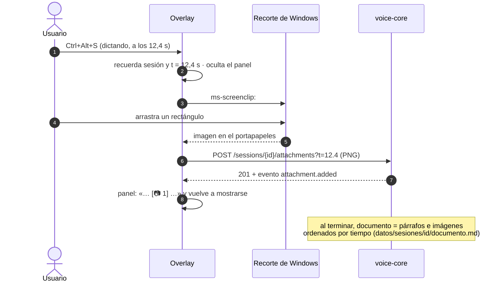

# F3 · Capturas, editor de sesiones y «Copiar para IA»

Estado: **cerrada el 2026-10-21**. Probada por el usuario con capturas durante un dictado real, el editor y las dos
formas de pasarlo a la IA.


## Objetivo

Acompañar el dictado con capturas de pantalla que quedan **en el punto del texto donde las tomaste**, corregir el
resultado en un editor con las imágenes en su sitio, y pasarlo a la IA en dos sabores: a un **chat** (texto con
`[Imagen N]` + arrastrar las imágenes) o a un **agente** (un `.md` con rutas a las PNG).

## Decisiones del usuario (2026-10-21)

| Tema | Decisión |
|---|---|
| Capturas | `Ctrl+Alt+S` abre el **recorte de Windows** (`ms-screenclip:`). Lo recortado se adjunta al dictado en curso, en el instante en que pulsaste; sin dictado activo, al último. |
| Editor | **Ventana propia** (Qt), desde el panel o la bandeja: lista de sesiones + documento con las imágenes en su sitio. |
| Para la IA | **Las dos**: «Copiar para chat» + arrastrar las imágenes; «Copiar para agente» (Markdown con rutas absolutas) y `documento.md` en la carpeta de la sesión. |

## No objetivos

- Sin dibujar ni anotar sobre las capturas (para eso, el recorte de Windows ya permite editar antes de copiar).
- Sin borrar sesiones ni adjuntos desde la API (quitar una imagen del documento basta; el archivo se conserva).
- Sin organizador de tareas (F4) ni MCP (F5).

## Flujo



## Cambios en voice-core

### Base de datos (migración `0002_adjuntos_documento.sql`)

- Tabla `attachments`: `id`, `session_id`, `kind` (`imagen`), `t` (segundos desde el inicio), `file` (relativo a la
  carpeta de la sesión, `capturas/001.png`), `width`, `height`, `created_at`.
- Columnas nuevas en `sessions`: `document` (Markdown editado; `NULL` = se genera) y `edited_at`.

### Documento

Generado a partir de segmentos y adjuntos, por tiempo: cada imagen va **después de la frase que estabas diciendo**
cuando la tomaste (tras el último segmento con `t0 ≤ t`). Las frases consecutivas forman un párrafo.

```markdown
# Dictado · 2026-10-21 18:40

Revisa la figura 3: la leyenda tapa la curva del modelo.


Además, el eje X no coincide con el del texto.
```

Al editar, se guarda tal cual (con los párrafos re-unidos: el editor parte líneas a 80 columnas). Se escribe también
`datos/sesiones/<id>/documento.md` con rutas relativas, para entregar la carpeta entera a un agente.

### Contratos (aditivos)

| Método y ruta | Cuerpo | Respuesta | Errores |
|---|---|---|---|
| `POST /sessions/{id}/attachments` | PNG (`image/png`), `?t=12.4` opcional | `AttachmentOut` (201) | 404, 413 (> 25 MB), 415 (no es PNG) |
| `GET /sessions/{id}/attachments/{aid}` | — | la imagen | 404 |
| `GET /sessions/{id}/document` | — | `DocumentOut` | 404 |
| `PUT /sessions/{id}/document` | `DocumentIn` | `DocumentOut` | 404, 409 si sigue grabando |
| `DELETE /sessions/{id}/document` | — | `DocumentOut` (vuelve al generado) | 404 |
| `GET /sessions/{id}/export` | `?format=md \| chat \| txt` | texto | 404, 422 |

- `t` omitido: durante el dictado, el instante actual; si ya terminó, el final de la sesión.
- `export?format=md`: Markdown con **rutas absolutas** a las imágenes (para agentes). `chat`: sin título, imágenes
  como `[Imagen N]`. `txt`: solo el texto.
- `SessionOut` gana `attachments` (número) y `edited_at`; `SessionDetailOut`, la lista de adjuntos.
- Eventos nuevos: `attachment.added` (`session_id`, `attachment`) y `session.edited` (`session_id`, `edited_at`).

## Overlay

- `Ctrl+Alt+S` (configurable en `[overlay] capturar`): oculta el panel, lanza el recorte, espera la imagen hasta 60 s
  (si cancelas con Esc, no pasa nada) y la sube. El panel muestra `[📷 N]` en el texto en vivo.
- **Editor** (botón ✎ del panel, menú de la bandeja): lista de sesiones (fecha, modo, nº de capturas, primeras
  palabras) y documento editable con las imágenes escaladas al ancho. Botones: Guardar (Ctrl+S), Volver al original,
  Copiar para chat, **Arrastrar N imágenes** (se sueltan todas a la vez en el chat), Copiar para agente, Abrir carpeta,
  Insertar captura (recorte → imagen en la posición del cursor).
- `Ctrl+Alt+V` pega el texto para chat de la última sesión (el editado, si lo hay).

## Criterios de aceptación

- [x] 1. Con `Ctrl+Alt+S` durante un dictado, la captura queda en `datos/sesiones/<id>/capturas/` y en el documento
  justo después de la frase que se estaba diciendo. *(Prueba real: capturas a los 13,4 s y a los 46,3 s de un dictado
  de 1:51; cada una quedó tras la frase en curso y el panel mostró `[📷 1]` y `[📷 2]` en el texto en vivo.)*
- [x] 2. Cancelar el recorte no deja adjuntos ni errores. *(Cubierto por test y confirmado con Esc en la revisión de
  F4, 2026-10-22.)*
- [x] 3. El documento generado intercala párrafos e imágenes por tiempo y se escribe en `documento.md` con rutas
  relativas.
- [x] 4. Editar y guardar persiste el texto (sin cortes de línea dentro de los párrafos), emite `session.edited` y
  «Volver al original» lo deshace. *(Prueba real: dos sesiones corregidas y guardadas; «Volver al original»,
  cubierto por tests.)*
- [x] 5. «Copiar para chat» deja el texto con `[Imagen N]`; «Arrastrar N imágenes» suelta todas las PNG en el chat de
  un navegador o app; «Copiar para agente» deja Markdown con rutas absolutas existentes. *(Confirmado por el usuario;
  las rutas de `export?format=md` apuntan a archivos que existen, también con espacios en la ruta.)*
- [x] 6. `POST /attachments` rechaza lo que no es PNG (415) o pesa más de 25 MB (413).
- [x] 7. Los contratos se regeneran y el test de deriva pasa; la migración se aplica sola sobre una base de F1/F2.
  *(La base real, con 8 sesiones de F1/F2, se migró al reiniciar la bandeja sin perder nada.)*
- [x] 8. Tests sin GPU para documento, adjuntos, API y editor (offscreen).

## Pruebas

- **110 tests sin GPU** (`.venv\Scripts\python -m pytest`). Los nuevos de F3:
  - `test_documento.py`: posición de cada imagen por tiempo (entre frases, al principio, al final, sin frases),
    párrafos re-unidos sin tocar títulos ni imágenes, texto para chat, Markdown para agente con espacios en la ruta y
    renumeración de «Imagen N» tras editar.
  - `test_api_documento.py`: captura durante y después del dictado, 415 y 413, descarga de la PNG, editar → guardar
    → volver al original, captura tras editar (va al final), 409 si sigue grabando y eventos por WebSocket.
  - `test_overlay_editor.py`: el editor en plataforma *offscreen* (imagen en su sitio, guardar sin cortes, copiar para
    chat y para agente, insertar en el cursor, imágenes escaladas al ancho) y el capturador con el portapapeles real
    de Qt (ignora texto, toma la imagen, se rinde si se cancela).
  - `test_overlay_estado.py`: marcas `[📷 N]` en el texto en vivo, aviso de captura con el dictado ya terminado y
    copia «para chat» al terminar si hubo capturas.
  - `test_almacen_y_contratos.py`: una base de F1 se migra sola sin perder datos.
- **Revisión visual:** `scripts/capturar_panel.py` renderiza el editor sin mostrarlo (`docs/img/editor.png`).

## Prueba real (2026-10-21)

| Qué | Resultado |
|---|---|
| Dictado de 1:51 con dos `Ctrl+Alt+S` | Dos PNG en `capturas/`, cada una tras su frase en el documento; el dictado siguió sin cortes mientras se recortaba |
| Al terminar | Portapapeles con `[Imagen 1]` y `[Imagen 2]` en su sitio; `documento.md` con rutas relativas |
| Editor | Dos sesiones corregidas y guardadas |
| Copiar para chat / para agente | Confirmados por el usuario |
| Sin comprobar a mano | «Insertar captura» desde el editor (cubierto por tests). Cancelar con Esc y capturar sin dictado activo se vieron en la revisión de F4 |

## Problemas encontrados y corregidos

| Problema | Causa | Corrección |
|---|---|---|
| Los párrafos guardados llegaban partidos en líneas de 80 caracteres | `QTextDocument.toMarkdown()` corta las líneas largas | `documento.unir_lineas` re-une los párrafos al guardar y al exportar, sin tocar títulos, listas ni imágenes |
| Una captura insertada con el cursor en el título salía como `# # ` | La imagen heredaba el formato de encabezado del bloque | Se inserta al final del bloque en un párrafo nuevo con formato limpio |
| El documento se pedía dos veces al abrir el editor | Al llenar la lista se elegía la sesión dos veces | Una sola elección |
| Barra de desplazamiento horizontal en la lista de sesiones | Rótulos más anchos que la columna | Rótulos en dos líneas con ajuste de texto y sin barra horizontal |

## Cómo usarlo

| Atajo o botón | Hace |
|---|---|
| `Ctrl+Alt+S` | abre el recorte de Windows; la imagen se adjunta al dictado en curso en ese instante (o al último, si no estás grabando) |
| ✎ en el panel · «Abrir el editor de dictados» en la bandeja | abre el editor en el último dictado |
| Guardar (`Ctrl+S`) | guarda la corrección; también se guarda sola al cambiar de dictado o cerrar |
| Volver al original | descarta las correcciones (pide confirmación) |
| Insertar captura | recorte → imagen bajo el párrafo del cursor |
| Copiar para chat | texto con `[Imagen N]`; después, arrastra «N imágenes» al chat para soltarlas todas a la vez |
| Copiar para agente | Markdown con rutas absolutas a las PNG (y `documento.md` en la carpeta) |
| Abrir carpeta | `datos/sesiones/<id>/`: `documento.md`, `capturas/` y `audio.wav` |

`Ctrl+Alt+V` pega la versión para chat del último dictado (la corregida, si la hay). El atajo de captura se cambia en
`[overlay] capturar` de `config/voice-core.toml`.
