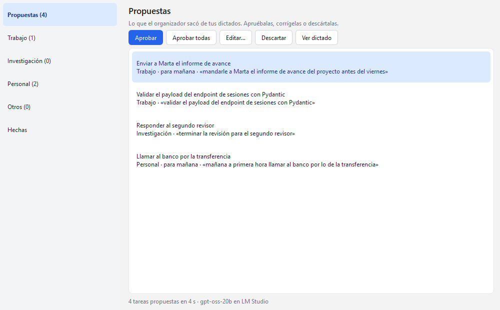
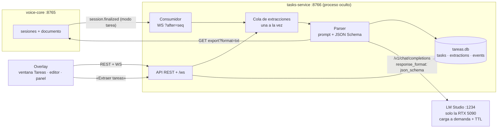

# F4 · Organizador de tareas con LM Studio

Estado: **cerrada el 2026-10-22**. Probada por el usuario con dictados reales de tareas, la ventana Tareas, el editor y
otro modelo ocupando la GPU de LM Studio; la revisión en vivo añadió la salvaguarda de la GPU y varios ajustes del
overlay ([Prueba real](#prueba-real-2026-10-22)).



## Objetivo

Convertir lo que dictas en **tareas pendientes por categoría** sin escribirlas a mano. Un servicio nuevo,
**tasks-service**, consume los dictados de voice-core como cualquier otro cliente, le pide a un modelo local de
LM Studio que extraiga las tareas en JSON y las deja en una **bandeja de propuestas** para que las apruebes, corrijas o
descartes. Las aprobadas forman la lista de cada categoría.

## Decisiones del usuario (2026-10-21)

| Tema | Decisión |
|---|---|
| Qué se convierte en tareas | Los dictados hechos con `Ctrl+Alt+T` (modo `tarea`) pasan solos al LLM. Cualquier otro dictado tiene un botón **«Extraer tareas»** en el editor. |
| Revisión | **Bandeja de propuestas**: el LLM nunca escribe directamente en la lista; tú apruebas, editas o descartas. |
| Interfaz | **Ventana Qt «Tareas»**, como el editor, desde el panel o la bandeja. |
| Modelo | Se decide **con una prueba** (como en F0): gpt-oss-20b frente a Qwen3.5-35B-A3B con dictados de tareas. Resultado: **gpt-oss-20b con `reasoning_effort=high`** ([Prueba de modelos](#prueba-de-modelos)). |

Revisión tras la primera prueba en vivo (2026-10-22): los 12 GB del modelo en la 5090 pueden chocar con otros
servicios del usuario que usan esa GPU. Decisiones ([Salvaguarda de la GPU](#salvaguarda-de-la-gpu)):

| Tema | Decisión |
|---|---|
| GPU ocupada al extraer | **Esperar y reintentar solo**: la extracción queda en cola con el motivo, el panel avisa y se procesa sola cuando la GPU se libera (se mira cada minuto). |
| Qué es «ocupada» | **Cualquier uso real**: más de 1 GB de VRAM usada o más de un 10 % de cómputo, aunque el modelo cupiera. |
| Cuándo se libera | **Al terminar la cola**: descarga explícita del modelo en cuanto no quedan extracciones; el TTL queda como red de seguridad. |
| Eco del glosario | Whisper a veces escribe el propio glosario («Términos frecuentes.») en una pausa: voice-core descarta esos trozos. |
| Abrir Tareas sin dictar | Atajo **`Ctrl+Alt+P`** (P de «pendientes»): abre la ventana, o la oculta si ya está delante. |
| Abrir el editor sin dictar | Atajo **`Ctrl+Alt+E`**: abre el editor en el último dictado, o lo oculta si ya está delante. Las ayudas de los iconos del panel (que no salían porque el panel nunca está activo) ahora se ven y dicen su atajo. |
| Parar mientras carga el modelo | **Se conserva lo grabado** y el panel lo dice: voice-core publica `session.stopped` al cerrar el micrófono; el panel para el reloj y muestra «Micrófono cerrado. Lo grabado se transcribe en cuanto termine de cargar el modelo…». ⏻ espera lo necesario en vez de fallar a los 5 s. |

## No objetivos

- Sin sincronizar con apps de tareas externas (Todoist, Microsoft To Do…) ni con calendarios.
- Sin recordatorios ni notificaciones por fecha; la fecha límite es informativa y ordena la lista.
- Sin subtareas, etiquetas ni prioridades (se pueden añadir después si hacen falta).
- Sin reconocer frases de voz como «nueva tarea: …» dentro de un dictado normal.
- Sin MCP ni webhooks (F5).

## Arquitectura



- **Proceso aparte**, con su propia base (`datos/tareas.db`), su API y sus eventos: igual que voice-core, lo puede
  consumir cualquier otro programa. El overlay lo lanza oculto y lo cierra con `POST /shutdown`, como a voice-core.
- **No pierde dictados**: guarda el último `seq` de voice-core que procesó y se reconecta con `?after=`. Si estaba
  apagado mientras dictabas, al arrancar procesa los dictados de tarea pendientes.
- **El texto que se analiza es el corregido**: `export?format=txt` devuelve el documento editado si lo hay.
- **Nunca toca CUDA.** La GPU la decide LM Studio: en este equipo tiene la 5080 desactivada, así que solo usa la 5090
  y no compite con el reconocimiento de voz.
- **Ligero**: el modelo se carga en LM Studio solo al extraer (carga a demanda), **solo si su GPU está libre**, y se
  descarga en cuanto termina la cola de extracciones (`ttl_s` queda como red de seguridad). Si el servidor de
  LM Studio no responde, se intenta arrancar con `lms server start`; si no, la extracción queda en error y se puede
  reintentar.

## Extracción

1. Llega `session.finalized` de una sesión `tarea` (o el usuario pulsa «Extraer tareas» en el editor) → se encola una
   extracción.
2. Se pide el texto (`export?format=txt`) y la fecha del dictado.
3. Se llama a LM Studio con un prompt fijo, las categorías con su descripción, la fecha del dictado (para resolver «el
   viernes», «mañana», «fin de mes») y un **JSON Schema** que obliga a devolver
   `{"tasks": [{"title", "category", "due", "notes", "quote"}]}` con `category` restringida a las categorías.
4. Cada tarea entra como `propuesta`. Repetir la extracción de una sesión **sustituye** sus propuestas pendientes (las
   ya aprobadas no se tocan).

Reglas del prompt: solo acciones pendientes que la persona se propone hacer o encargar; nada de opiniones, comentarios
ni cosas ya hechas; una tarea por acción aunque se repita; título breve en infinitivo que conserva nombres y términos
técnicos; si no hay tareas, lista vacía.

## Salvaguarda de la GPU

LM Studio decide en qué GPU carga el modelo (aquí, la 5090: la 5080 está desactivada en su configuración). tasks-service
no puede elegirla, pero sí decidir **cuándo** pedir la carga:

1. **Antes de cada extracción** lee la GPU de LM Studio (`[tareas] gpu`, UUID o parte del nombre) por **NVML**, que
   solo lee contadores y no crea contexto CUDA: tres lecturas en un segundo. Está **ocupada** si la VRAM usada pasa de
   `gpu_vram_max_mib` (1024) o el uso de cómputo medio pasa de `gpu_uso_max_pct` (10 %).
2. Si está ocupada, **no se llama a LM Studio**: la extracción sigue `en_cola` con el motivo en `waiting` («la RTX 5090
   está ocupada (3,2 GB en uso)»), el panel y la ventana Tareas lo avisan y se vuelve a mirar cada `reintento_gpu_s`
   (60 s). Si tasks-service se reinicia mientras espera, la retoma.
3. Si el modelo **ya está cargado** (la extracción anterior de la misma cola, o lo cargaste tú en LM Studio), no hay
   nada que reservar y no se espera.
4. **Al vaciarse la cola**, si el modelo lo cargó tasks-service, se descarga con `POST /api/v1/models/unload` de
   LM Studio. Un modelo que ya estaba cargado antes no se toca. Si la descarga falla, el `ttl` de la petición
   (`ttl_s`, ahora 120 s) lo descarga igualmente.

Con `gpu = ""` no se comprueba nada (para equipos donde LM Studio no comparte GPU con otros programas). Si NVML no
puede leer la GPU, se avisa en el registro y se extrae igualmente.

Coste: cada extracción paga la carga del modelo (≈ 7–9 s en frío, menos con el archivo en la caché del sistema), a
cambio de que los 12 GB solo estén ocupados mientras se extrae.

## Categorías

Configurables en `config/voice-core.toml`, con una descripción que ayuda al modelo a elegir:

```toml
[tareas.categorias]
Trabajo = "proyectos, código, reuniones, correos y entregas del trabajo"
Investigación = "artículos, experimentos, lecturas y revisiones"
Personal = "casa, salud, trámites y compras"
```

Siempre existe **Otros** para lo que no encaje. Renombrar o quitar una categoría no borra sus tareas: siguen visibles
con su nombre (`configured: false` en la API) hasta que las muevas a otra.

## Contratos (tasks-service, `127.0.0.1:8766`)

| Método y ruta | Cuerpo / parámetros | Respuesta | Errores |
|---|---|---|---|
| `GET /health` | — | `HealthOut` | — |
| `GET /llm` | — | `LlmOut`: URL, modelo, si responde y si está cargado | — |
| `GET /categories` | — | `list[CategoryOut]` (nombre, descripción, pendientes, propuestas) | — |
| `GET /tasks` | `?status=propuesta \| pendiente \| hecha \| descartada` · `?category=` · `?limit=` | `list[TaskOut]` | 422 |
| `POST /tasks` | `TaskIn` (`title`, `category`, `due?`, `notes?`) | `TaskOut` (201, `pendiente`) | 422 |
| `PATCH /tasks/{id}` | `TaskPatch` (cualquiera de `title`, `category`, `due`, `notes`, `status`) | `TaskOut` | 404, 422 (categoría desconocida o volver a `propuesta`) |
| `POST /extractions` | `{"session_id": "…"}` | `ExtractionOut` (202) | 404 si voice-core no tiene esa sesión, 409 si sigue grabando, 503 si voice-core no responde |
| `GET /extractions` | `?session_id=` · `?limit=` | `list[ExtractionOut]` | 422 |
| `GET /events` · `WS /ws` | `?after=N` · `?limit=` (solo `/events`) | eventos con `seq`, como en voice-core | 422 |
| `POST /shutdown` | — | 202 | 409 si el servicio no admite cierre por la API |

- `TaskOut`: `id`, `title`, `category`, `due` (`YYYY-MM-DD` o `null`), `notes`, `status`, `session_id`,
  `extraction_id`, `quote` (fragmento del dictado), `created_at`, `updated_at`, `done_at`.
- `ExtractionOut`: `id`, `session_id`, `origin` (`auto` \| `manual`), `status` (`en_cola` \| `procesando` \| `lista` \|
  `error`), `model`, `tasks` (cuántas propuso), `duration_s`, `error`, `waiting` (motivo por el que sigue en cola,
  p. ej. GPU ocupada; `null` si no espera), `created_at`.
- Eventos: `task.created` y `task.updated` (con la `TaskOut`), `extraction.updated` (con la `ExtractionOut` en cada
  cambio de estado).
- Contratos exportados a `contracts/tareas.openapi.json` y `contracts/tareas.eventos.schema.json`, con su test de deriva.

## Prueba de modelos

`spikes/f4/banco.py` pasa 14 dictados de tarea inventados ([`spikes/f4/dictados.json`](../spikes/f4/dictados.json),
al estilo de lo que sale de Whisper) por cada modelo, con **el mismo prompt y el mismo esquema que el servicio**, y
compara con lo esperado. Los casos difíciles: dictados sin tareas, cosas ya hechas, autocorrecciones («el lunes, no,
mejor el martes»), encargos a otra persona, la misma tarea dicha dos veces y fechas relativas («el jueves de la semana
que viene», «fin de mes»). Fecha del dictado: miércoles 21 de octubre de 2026. LM Studio en la 5090, carga en frío
medida aparte.

| Modelo y ajuste | Dictados perfectos | Tareas halladas | Categoría | Fecha | Mediana | Máx. | Carga | VRAM (5090) |
|---|---|---|---|---|---|---|---|---|
| gpt-oss-20b (por defecto) | 12/14 | 23/24 | 23/24 | 16/17 | 0,7 s | 1,1 s | 6,6 s | 12,0 GB |
| gpt-oss-20b, `reasoning_effort=medium` | 13/14 | 24/24 | 25/25 | 17/18 | 1,9 s | 3,9 s | 7,0 s | 12,0 GB |
| **gpt-oss-20b, `reasoning_effort=high`** | **14/14** | **24/24** | **25/25** | **18/18** | **4,3 s** | 9,2 s | 8,8 s | 12,0 GB |
| Qwen3.5-35B-A3B | 14/14 | 24/24 | 25/25 | 18/18 | 12,6 s | 20,5 s | 22,6 s | 22,1 GB |
| Qwen3.5-35B-A3B, sin pensar (`enable_thinking: false`) | 14/14 | igual | igual | igual | 12,2 s | 20,2 s | 14,6 s | 22,1 GB |

- Ninguna configuración inventó tareas en los dictados sin tareas ni devolvió JSON inválido (el esquema lo impone
  LM Studio al generar).
- El fallo típico de gpt-oss con poco razonamiento es la **fecha**: «el sábado» → el sábado de la semana siguiente.
  Con `high` lo resuelve; por eso el prompt incluye un calendario de los próximos 21 días.
- Qwen3.5 acierta todo pero razona 860–4.600 tokens por dictado (≈ 3× más lento y casi el doble de memoria); LM
  Studio ignora `enable_thinking: false` para este modelo.
- **Elegido: gpt-oss-20b con `reasoning_effort=high`.** Se puede cambiar en `[tareas]` sin tocar código.
- En ninguna prueba cambió la memoria de la 5080 (LM Studio tiene esa GPU desactivada).
- Al cerrar F4 (2026-10-22), una categoría y cuatro dictados del banco se reescribieron con temas genéricos (los
  mismos casos y la misma estructura) para no publicar temas personales; las cifras de la tabla son de la versión
  original.

Prueba de punta a punta con el servicio real (puerto aparte, base temporal): extraer de un dictado real tardó 17,6 s
con el modelo en frío (carga incluida) y dejó una propuesta.

## Overlay

- **Ventana «Tareas»** (**`Ctrl+Alt+P`**, botón ☑ del panel y menú de la bandeja; el atajo la oculta si ya está
  delante): a la izquierda, **Propuestas (N)**, cada categoría con sus pendientes y **Hechas**; a la derecha, la
  lista. En propuestas: Aprobar, Aprobar todas, Editar, Descartar y «Ver dictado» (abre el editor en esa sesión); al
  aprobar, el pie dice adónde fue cada una («Aprobadas, en sus listas: Trabajo (2), Personal (1)»). En las listas:
  casilla para marcar hecha, doble clic para editar (título, categoría, fecha, notas) y una línea para añadir tareas
  a mano.
- **Editor** (`Ctrl+Alt+E`, nuevo): botón «Extraer tareas» para cualquier dictado terminado.
- **Panel**: al terminar un dictado de tarea, «Buscando tareas en el dictado…» y después «3 tareas propuestas:
  revísalas en Tareas», «Tareas en espera: la RTX 5090 está ocupada (…)» o el error. Las ayudas de sus iconos se ven
  al pasar el ratón y dicen el atajo.

## Criterios de aceptación

- [x] 1. Un dictado con `Ctrl+Alt+T` acaba, sin hacer nada más, con sus tareas en «Propuestas» y un aviso en el panel.
  *(Prueba real: 3 tareas en 23,8 s con el modelo en frío.)*
- [x] 2. «Extraer tareas» en el editor funciona con cualquier dictado terminado, y repetirlo no duplica propuestas.
  *(Tres extracciones del mismo dictado dejaron una sola propuesta; las dos anteriores quedaron sustituidas.)*
- [x] 3. Aprobar, editar, descartar, marcar hecha y añadir a mano persisten y se ven al reabrir la ventana.
  *(Comprobado por la API tras cada operación.)*
- [x] 4. Las fechas relativas («el viernes», «mañana») se resuelven respecto al día del dictado. *(«hoy», «mañana,
  viernes 31; no, viernes 23», «el sábado» y «el lunes» bien resueltos, autocorrección incluida.)*
- [x] 5. Si tasks-service estaba apagado durante un dictado de tarea, lo procesa al arrancar; ningún dictado se procesa
  dos veces solo. *(Una sola extracción al arrancar y ninguna más tras «Salir» y volver a lanzar.)*
- [x] 6. Con LM Studio cerrado, se arranca su servidor; si no se puede, la extracción queda en error con un mensaje
  claro y se puede reintentar. *(Prueba real: `lms server start` y 6 tareas en 45 s, arranque y carga incluidos; el
  caso de error, cubierto por tests.)*
- [x] 7. El modelo se descarga de LM Studio al terminar la cola de extracciones (o, como red de seguridad, tras
  `ttl_s`) y nunca se carga en la 5080. *(Antes de la salvaguarda, por TTL a los 600 s; después, en el acto al
  vaciarse la cola: dos extracciones seguidas cargaron el modelo una vez y lo descargaron una vez. En la 5080 nunca
  apareció `llama-server`.)*
- [x] 8. Contratos generados con test de deriva; tests sin GPU ni LM Studio (LLM falso) para parser, almacén, API,
  consumidor, salvaguarda y ventana.
- [x] 9. Con la GPU de LM Studio ocupada por otro programa, la extracción no la toca: espera con aviso en el panel y se
  hace sola cuando la GPU se libera. *(Con otro modelo de 21,9 GB cargado en LM Studio, esperó; al expulsarlo, siguió
  sola en menos de un minuto.)*
- [x] 10. Whisper no deja en el texto trozos del glosario («Términos frecuentes.»). *(Visto dos veces antes del filtro;
  ninguna en los dictados posteriores.)*

## Pruebas

- **146 tests sin GPU** (`.venv\Scripts\python -m pytest`). Los de F4:
  - `test_tareas_parser.py`: «Otros» una sola vez, esquema cerrado (categorías y formato de fecha), prompt con fecha,
    calendario de 21 días y categorías, y `interpretar` (limpia, valida, quita repetidas, pone en mayúscula la inicial
    y acepta JSON envuelto).
  - `test_tareas_servicio.py`: el servicio con un LLM y un voice-core falsos: propuestas con su origen, repetir
    sustituye, errores (404, 409, 503, LM Studio caído, respuesta rota), dictado vacío, aprobar/editar/hecha/reabrir,
    tareas a mano, eventos por WebSocket, consumidor (una vez por dictado, nada anterior a la instalación), retomar al
    arrancar, **espera con la GPU ocupada** y **descarga al vaciarse la cola** (no si el modelo ya estaba cargado).
  - `test_tareas_gpu.py`: cuándo la GPU cuenta como ocupada (memoria, cómputo sostenido, picos sueltos) y el vigía
    con un lector de NVML falso.
  - `test_overlay_tareas.py`: la ventana (vistas, aprobar con su resumen, eventos, aviso de espera, marcar hecha,
    añadir) y «Extraer tareas» en el editor.
  - `test_overlay_estado.py`, `test_segmentador.py`, `test_api.py`: `session.stopped` y el panel al parar mientras
    carga el modelo; eco del glosario; orden de eventos.
- **Banco de modelos:** `spikes/f4/banco.py` ([Prueba de modelos](#prueba-de-modelos)).

## Prueba real (2026-10-22)

| Qué | Resultado |
|---|---|
| `Ctrl+Alt+T` con tres tareas sin fecha | 3 propuestas en 23,8 s (carga en frío) y aviso en el panel |
| `Ctrl+Alt+T` con LM Studio cerrado y seis tareas con fechas relativas | `lms server start`, 6 propuestas en 45 s con las fechas bien, autocorrección incluida |
| Ventana Tareas | Aprobar, Aprobar todas, Editar, Descartar, marcar hecha y añadir a mano, comprobados por la API |
| Otro modelo de 21,9 GB en la 5090 | Extracción en espera con aviso; al expulsarlo, siguió sola y el modelo se descargó al acabar |
| «Extraer tareas» ×2 en el editor | Una sola propuesta; el modelo se cargó y descargó una vez para las dos |
| tasks-service apagado durante un dictado de tarea | Procesado una vez al arrancar; ninguna repetición tras «Salir» y relanzar |
| Pendientes de F2 y F3 | `Ctrl+Alt+V` sujetando Ctrl y Alt, «Salir» sin procesos residuales (ahora también tasks-service) y Esc en el recorte: confirmados |
| GPU | El modelo, siempre en la 5090 (12 GB); la 5080, solo con Whisper |

## Problemas encontrados y corregidos

| Problema | Causa | Corrección |
|---|---|---|
| Los 12 GB del modelo podían chocar con otros servicios del usuario en la 5090 | LM Studio carga a demanda sin mirar quién usa la GPU, y el TTL lo dejaba 10 min | [Salvaguarda de la GPU](#salvaguarda-de-la-gpu): espera si está ocupada y descarga al vaciarse la cola (TTL 120 s de reserva) |
| «Aprobar todas» parecía perder una tarea | Las tareas iban a categorías distintas y el aviso de la acción lo tapaba el repintado de la lista | El aviso dice adónde fue cada una y ya no lo tapa el repintado |
| Un término del trabajo del usuario salía mal escrito en el título | Error de Whisper (la cita ya venía mal), no del LLM | Glosario personal; el editor permite corregir y volver a extraer |
| «Términos frecuentes.» aparecía en el texto | Whisper repite en una pausa el glosario que recibe como `initial_prompt` | `eco_del_glosario`: se descartan los trozos del glosario que no son uno de sus términos |
| Al parar mientras cargaba el modelo, el panel seguía con «Escuchando…» y ⏻ daba «timed out» | voice-core no avisaba del cierre del micrófono; ⏻ espera a transcribir lo grabado y el cliente se rendía a los 5 s | Evento `session.stopped`; el panel para el reloj y lo explica; ⏻ espera lo necesario |
| No había forma de abrir Tareas o el editor sin pasar por el panel | — | `Ctrl+Alt+P` (Tareas) y `Ctrl+Alt+E` (editor) |
| Las ayudas de los iconos del panel no salían | Qt solo las muestra en ventanas activas y el panel nunca lo está | `WA_AlwaysShowToolTips`; las ayudas dicen su atajo |
| `Ctrl+Alt+V` no pegaba si se sujetaban Ctrl y Alt más de 2 s, sin avisar | Plazo corto y fallo solo en el registro | Espera hasta 6 s y, si no, el panel avisa de que el texto está en el portapapeles |
| Títulos en minúscula («revisar el presupuesto…») | El modelo copió el dictado tal cual | `interpretar` pone en mayúscula la inicial |
| Tras reiniciar la bandeja, el overlay nuevo podía hablar con el tasks-service viejo | El procedimiento de reinicio solo paraba voice-core | Parar también tasks-service (`POST :8766/shutdown`) |

## Cómo usarlo

| Atajo o botón | Hace |
|---|---|
| `Ctrl+Alt+T` | dictado de tareas: al terminar, el organizador propone las tareas y el panel avisa |
| `Ctrl+Alt+P` · ☑ en el panel · «Abrir las tareas» en la bandeja | abre la ventana Tareas (el atajo la oculta si ya está delante) |
| Aprobar · Aprobar todas | pasan las propuestas a la lista de su categoría |
| Editar… (o doble clic) · Descartar | corrige título, categoría, fecha y notas · quita la propuesta |
| Casilla de una tarea · línea de abajo | la marca como hecha · añade una tarea a mano en esa categoría |
| `Ctrl+Alt+E` · ✎ en el panel | abre el editor; «Extraer tareas» busca tareas en cualquier dictado (repetirlo sustituye las propuestas) |

Requisitos: LM Studio con su servidor local y el modelo `openai/gpt-oss-20b` descargado (con la carga a demanda
activada). Las categorías se cambian en `[tareas.categorias]` y la salvaguarda en `[tareas] gpu` (UUID o parte del
nombre de la GPU de LM Studio; vacío = sin comprobar) de `config/voice-core.toml`.
